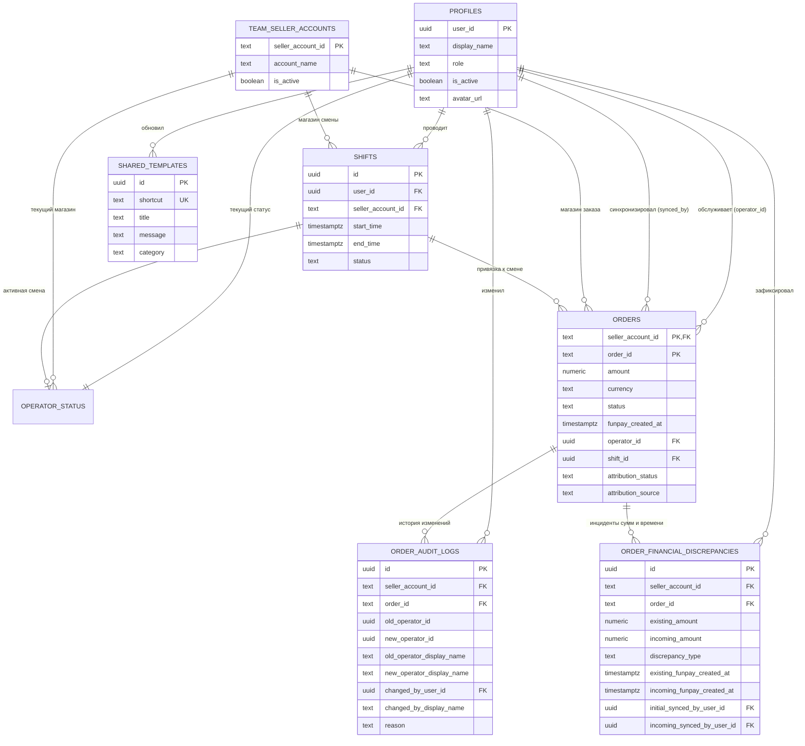

# Обзор схемы данных FunPay Team Dashboard v2.4

---

## 1. Диаграмма связей сущностей (Entity-Relationship Diagram)

---

## 2. Каталог таблиц и структур данных

### 2.1. `public.profiles`
Профили участников команды (привязаны 1:1 к `auth.users`).
* `user_id` (UUID, PK, FK `auth.users.id` ON DELETE CASCADE) — Идентификатор пользователя.
* `display_name` (TEXT, NOT NULL) — Отображаемое имя оператора.
* `role` (TEXT, NOT NULL, DEFAULT `'operator'`, CHECK `role IN ('owner', 'operator')`) — Роль участника.
* `is_active` (BOOLEAN, NOT NULL, DEFAULT `true`) — Флаг активности аккаунта.
* `avatar_url` (TEXT) — Ссылка на аватар.
* `created_at` / `updated_at` (TIMESTAMPTZ, NOT NULL, DEFAULT `NOW()`).
* **Триггер:** `trg_protect_profile_fields` (блокирует изменение `user_id`, `created_at`, а также самостоятельное изменение `role` и `is_active`).
* **Видимость RLS:** Пользователь видит свой профиль; активные участники видят только активных коллег (`is_active = true`); руководитель видит всех, включая деактивированных.

### 2.2. `public.team_seller_accounts`
Реестр авторизованных магазинов FunPay команды.
* `seller_account_id` (TEXT, PK) — Неизменяемый цифровой ID аккаунта FunPay (например `'1084291'`).
* `account_name` (TEXT, NOT NULL) — Название магазина («Основной Robux», «Запасной»).
* `is_active` (BOOLEAN, NOT NULL, DEFAULT `true`) — Активен ли приём заказов.
* `created_at` / `updated_at` (TIMESTAMPTZ, NOT NULL, DEFAULT `NOW()`).

### 2.3. `public.shifts`
Рабочие смены операторов с защитой жизненного цикла.
* `id` (UUID, PK, DEFAULT `gen_random_uuid()`).
* `user_id` (UUID, NOT NULL, FK `profiles.user_id` ON DELETE RESTRICT).
* `seller_account_id` (TEXT, NOT NULL, FK `team_seller_accounts.seller_account_id` ON DELETE RESTRICT).
* `start_time` (TIMESTAMPTZ, NOT NULL, DEFAULT `NOW()`) — Время начала смены.
* `end_time` (TIMESTAMPTZ) — Время закрытия (NULL для активных).
* `duration_seconds` (INTEGER, NOT NULL, DEFAULT 0, CHECK `duration_seconds >= 0`) — Длительность в секундах.
* `status` (TEXT, NOT NULL, DEFAULT `'active'`, CHECK `status IN ('active', 'completed')`).
* `created_at` / `updated_at` (TIMESTAMPTZ, NOT NULL).
* **Индекс уникальности:** `idx_shifts_one_active_per_user` (`UNIQUE (user_id) WHERE status = 'active'`).
* **Триггер:** `trg_protect_shift_fields` (автоматический расчёт длительности, фиксация end_time моментом закрытия, запрет операторам менять закрытые смены, корректировка границ доступна только owner).

### 2.4. `public.operator_status`
Живое присутствие (heartbeat) операторов.
* `user_id` (UUID, PK, FK `profiles.user_id` ON DELETE CASCADE).
* `status` (TEXT, NOT NULL, DEFAULT `'offline'`, CHECK `status IN ('offline', 'online', 'on_shift', 'break')`).
* `active_shift_id` (UUID, FK `shifts.id` ON DELETE SET NULL).
* `current_seller_account_id` (TEXT, FK `team_seller_accounts.seller_account_id` ON DELETE SET NULL).
* `app_version` (TEXT, NOT NULL, DEFAULT `'2.1.0'`).
* `last_heartbeat_at` / `updated_at` (TIMESTAMPTZ, NOT NULL, DEFAULT `NOW()`).
* **Триггер:** `trg_validate_operator_status` (статус `on_shift` строго требует реальной активной смены этого же оператора; при статусах `offline` и `online` связанные поля смены и магазина очищаются в NULL).

### 2.5. `public.orders`
Реестр заказов FunPay. Прямая запись закрыта (только чтение и RPC).
* `seller_account_id` (TEXT, NOT NULL, FK `team_seller_accounts.seller_account_id` ON DELETE RESTRICT).
* `order_id` (TEXT, NOT NULL) — Номер заказа FunPay без `#` (например `'ABC12345'`).
* **Первичный ключ:** `PRIMARY KEY (seller_account_id, order_id)`.
* `buyer_id` (TEXT) — Цифровой ID покупателя.
* `buyer_username` (TEXT) — Никнейм покупателя.
* `title` (TEXT) — Название товара.
* `description` (TEXT) — Описание лота.
* `subcategory` (TEXT) — Категория/игра.
* `amount` (NUMERIC(12,2), NOT NULL, CHECK `amount > 0`) — Сумма сделки.
* `currency` (TEXT, NOT NULL, CHECK `currency IN ('RUB', 'USD', 'EUR', 'KZT')`) — Валюта.
* `status` (TEXT, NOT NULL, CHECK `status IN ('paid', 'closed', 'refunded')`).
* `funpay_created_at` (TIMESTAMPTZ, NOT NULL) — Фактическое время заказа на FunPay.
* `operator_id` (UUID, FK `profiles.user_id` ON DELETE SET NULL) — Назначенный оператор.
* `shift_id` (UUID, FK `shifts.id` ON DELETE SET NULL) — Смена, в которую попал заказ.
* `attribution_status` (TEXT, NOT NULL, DEFAULT `'unassigned'`, CHECK `attribution_status IN ('unassigned', 'assigned', 'ambiguous')`).
* `attribution_source` (TEXT, NOT NULL, DEFAULT `'none'`, CHECK `attribution_source IN ('none', 'automatic', 'manual')`).
* `synced_by_user_id` (UUID, NOT NULL, FK `profiles.user_id` ON DELETE RESTRICT) — Автор первой синхронизации.
* `last_synced_at` / `created_at` / `updated_at` (TIMESTAMPTZ, NOT NULL).
* **Триггер:** `trg_protect_order_fields` (иммутабельность `amount`, `currency`, `funpay_created_at`, `buyer_id`, `created_at`, `synced_by_user_id`, `seller_account_id`, `order_id`).

### 2.6. `public.order_audit_logs`
Журнал ручных переназначений заказов.
* `id` (UUID, PK, DEFAULT `gen_random_uuid()`).
* `seller_account_id` / `order_id` (TEXT, NOT NULL, FK `orders` ON DELETE RESTRICT) — Заказ нельзя удалить, если ведётся аудит.
* `old_operator_id` / `new_operator_id` (UUID, FK `profiles.user_id` ON DELETE SET NULL).
* `old_operator_display_name` / `new_operator_display_name` (TEXT) — Снимки имён на момент изменения.
* `old_attribution_status` / `new_attribution_status` (TEXT, NOT NULL).
* `old_attribution_source` / `new_attribution_source` (TEXT, NOT NULL).
* `changed_by_user_id` (UUID, FK `profiles.user_id` ON DELETE SET NULL).
* `changed_by_display_name` (TEXT, NOT NULL) — Снимок имени инициатора.
* `reason` (TEXT, NOT NULL) — Причина корректировки.
* `created_at` (TIMESTAMPTZ, NOT NULL, DEFAULT `NOW()`).

### 2.7. `public.order_financial_discrepancies`
Журнал обнаруженных расхождений финансовых сумм и времени.
* `id` (UUID, PK, DEFAULT `gen_random_uuid()`).
* `seller_account_id` / `order_id` (TEXT, NOT NULL, FK `orders` ON DELETE RESTRICT).
* `existing_amount` / `existing_currency` (NUMERIC / TEXT, зафиксированные данные базы).
* `incoming_amount` / `incoming_currency` (NUMERIC / TEXT, данные повторной попытки).
* `discrepancy_type` (TEXT, NOT NULL, CHECK `discrepancy_type IN ('amount_currency', 'created_at_mismatch')`).
* `existing_funpay_created_at` / `incoming_funpay_created_at` (TIMESTAMPTZ).
* `initial_synced_by_user_id` (UUID, NOT NULL, FK `profiles.user_id` ON DELETE RESTRICT).
* `incoming_synced_by_user_id` (UUID, NOT NULL, FK `profiles.user_id` ON DELETE RESTRICT).
* `detected_at` (TIMESTAMPTZ, NOT NULL, DEFAULT `NOW()`).
* **Уникальность:** `UNIQUE (seller_account_id, order_id, incoming_synced_by_user_id, incoming_amount, incoming_currency, discrepancy_type)`.

### 2.8. `public.shared_templates`
Общие шаблоны ответов.
* `id` (UUID, PK, DEFAULT `gen_random_uuid()`).
* `shortcut` (TEXT, NOT NULL, UNIQUE) — Горячая клавиша (`'F1'`, `'F2'` и т.д.).
* `title` / `message` / `category` / `sort_order` / `is_enabled` (TEXT / INT / BOOL).
* `updated_by_user_id` (UUID, FK `profiles.user_id` ON DELETE SET NULL).
* `created_at` / `updated_at` (TIMESTAMPTZ, NOT NULL).
* **Триггер:** `trg_shared_templates_audit` (автоматическое выставление `updated_at`, `updated_by_user_id := auth.uid()` и защита `created_at`).

---

## 3. Матрица безопасности и доступа

| Таблица / Ресурс | Роль `anon` | Роль `authenticated` (Оператор) | Роль `authenticated` (Руководитель / Owner) |
|---|:---:|:---:|:---:|
| `profiles` | ❌ Запрещено | `SELECT` (свой + активные коллеги), `UPDATE` (только свои display поля) | `SELECT` (все), `UPDATE` (все профили, роли и статус активности) |
| `team_seller_accounts` | ❌ Запрещено | `SELECT` (активные магазины) | `SELECT`, `INSERT`, `UPDATE`, `DELETE` (полное управление) |
| `shifts` | ❌ Запрещено | `SELECT`, `INSERT` (только себе), `UPDATE` (только закрытие своей) | `SELECT`, `UPDATE` (корректировка любых смен команды) |
| `operator_status` | ❌ Запрещено | `SELECT`, `UPSERT` (только свой статус с валидацией смены) | `SELECT`, `UPSERT` (свой статус) |
| `orders` | ❌ Запрещено | `SELECT` (все заказы). Прямой INSERT/UPDATE закрыт | `SELECT`. Прямой INSERT/UPDATE закрыт |
| `order_audit_logs` | ❌ Запрещено | `SELECT` (прозрачность для команды). Запись закрыта | `SELECT`. Запись закрыта |
| `order_financial_discrepancies` | ❌ Запрещено | ❌ Скрыто политикой RLS | `SELECT` (полный доступ к инцидентам) |
| `shared_templates` | ❌ Запрещено | `SELECT`, `INSERT`, `UPDATE`, `DELETE` | `SELECT`, `INSERT`, `UPDATE`, `DELETE` |
| RPC `sync_orders_batch` | ❌ Запрещено | `EXECUTE` (до 50 заказов) | `EXECUTE` |
| RPC `reassign_order_operator` | ❌ Запрещено | `EXECUTE` (с аудитом) | `EXECUTE` |
| RPC `recalculate_shift_attributions` | ❌ Запрещено | `EXECUTE` (только свои смены) | `EXECUTE` (любые смены команды) |
| Функция `bootstrap_initial_owner` | ❌ Запрещено | ❌ Запрещено | Доступна только `service_role` / `postgres` |

---

## 4. Каталог RPC-функций

1. **`public.sync_orders_batch(p_seller_account_id TEXT, p_orders JSONB) RETURNS JSONB`**
   * *Контекст:* `SECURITY DEFINER`, `search_path = public, pg_temp`.
   * *Авторизация:* Доступен только `authenticated` операторам с валидным `auth.uid()`.
   * *Ограничение:* Не более 50 заказов за вызов.
   * *Валидация:* Строгий regex `^[0-9]+(\.[0-9]{1,2})?$` для суммы; строгий контроль длин строк; проверка NULL.
   * *Логика:* First-Write-Wins; атомарный `INSERT ON CONFLICT DO NOTHING`; логирование расхождений сумм и времени в `order_financial_discrepancies`; иерархия статусов `refunded > closed > paid`; сохранение ручной атрибуции. Без использования `MAX(UUID)`.
2. **`public.reassign_order_operator(p_seller_account_id TEXT, p_order_id TEXT, p_new_operator_id UUID, p_reason TEXT) RETURNS VOID`**
   * *Контекст:* `SECURITY DEFINER`, `search_path = public, pg_temp`.
   * *Авторизация:* Доступен только `authenticated`.
   * *Логика:* Блокировка `FOR UPDATE`; прямая проверка активности нового оператора; установка `attribution_source = 'manual'`; снимки имён в `order_audit_logs`.
3. **`public.recalculate_shift_attributions(p_shift_id UUID, p_window_start TIMESTAMPTZ, p_window_end TIMESTAMPTZ) RETURNS TABLE(...)`**
   * *Контекст:* `SECURITY DEFINER`, `search_path = public, pg_temp`.
   * *Авторизация:* Доступен только `authenticated`.
   * *Логика:* Блокировка смены `FOR UPDATE`; защита диапазона (оператор не может выйти за пределы своей смены); пересчёт заказов в окне смены (с поддержкой укороченных смен); сохранение `attribution_source = 'manual'`. Без использования `MAX(UUID)`.
4. **`public.bootstrap_initial_owner(p_target_user_id UUID) RETURNS VOID`**
   * *Контекст:* `SECURITY DEFINER`, `search_path = public, pg_temp`.
   * *Ограничение:* Доступен только `service_role` или суперпользователю `postgres`. Одноразовый: защищён `pg_advisory_xact_lock` от конкурентных вызовов.

---

## 5. Финансовая формула и раздельный учёт валют

В системе строго разграничены понятия оборота, операторской доли и фонда команды.

### 5.1. Учёт статусов без двойного вычитания
* **`paid` (Оплачен):** Товар выдан, но покупатель ещё не нажал «Подтвердить заказ». Находится в категории «В обработке (Pending)». **В подтверждённый оборот и расчёт выплат не входит.**
* **`closed` (Выполнен / Закрыт):** Успешная продажа. **Только этот статус формирует подтверждённый оборот.**
* **`refunded` (Возврат / Отмена):** Деньги возвращены покупателю. Заказ имеет статус `refunded`, поэтому он автоматически **не попадает** в выборку заказов со статусом `closed`.
* **Защита от двойного вычитания:** Так как оборот рассчитывается строго по заказам со статусом `closed`, сумма возвратов `refunded` не вычитается повторно!

### 5.2. Формула расчёта
Для каждой валюты $C \in \{\text{'RUB'}, \text{'USD'}, \text{'EUR'}, \text{'KZT'}\}$:

1. **Подтверждённый оборот оператора ($T_{\text{op}}$):**
   $$T_{\text{op}}(u, C) = \sum_{\substack{\text{status} = \text{'closed'} \\ \text{operator\_id} = u \\ \text{currency} = C}} \text{amount}$$

2. **Персональная доля оператора ($S_{\text{op}}$):**
   $$S_{\text{op}}(u, C) = 0.10 \times T_{\text{op}}(u, C)$$

3. **Общий оборот команды ($T_{\text{team}}$):**
   $$T_{\text{team}}(C) = \sum_{\substack{\text{status} = \text{'closed'} \\ \text{currency} = C}} \text{amount}$$
   *(Включает закрытые заказы всех операторов и непривязанные заказы `unassigned`)*.

4. **Остаток команды (Касса):**
   $$\text{Fund}(C) = T_{\text{team}}(C) - \sum_{u \in \text{Team}} S_{\text{op}}(u, C)$$
   *По непривязанным заказам (`unassigned`) операторская доля равна 0, и 100% суммы остаётся в фонде команды.*
